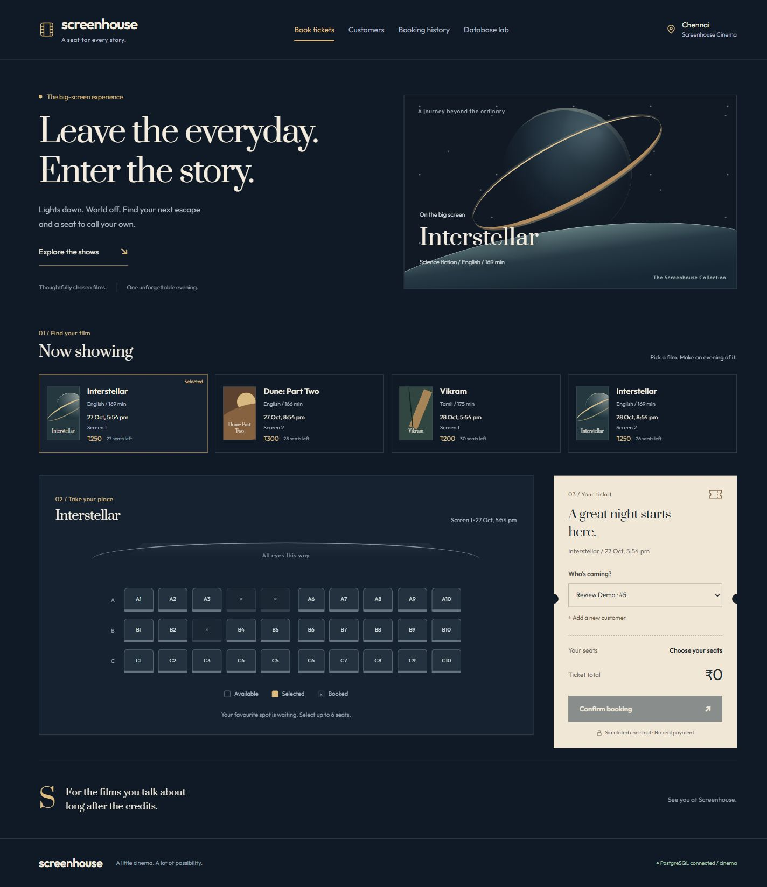
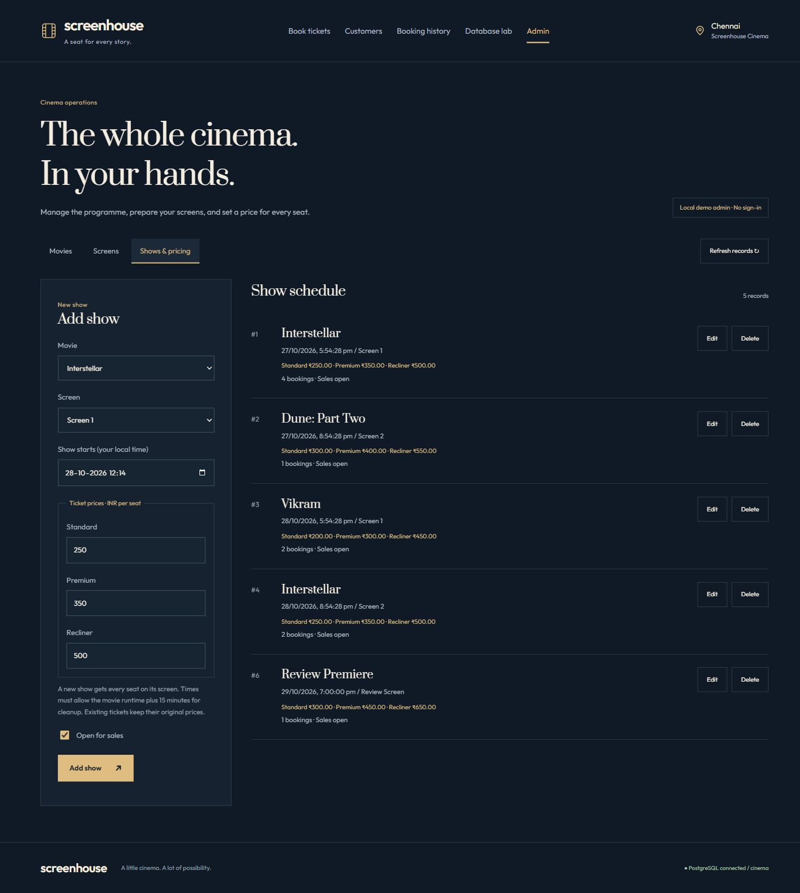

# Screenhouse — Movie Ticket Booking DBMS

A local, runnable DBMS review project: add a customer, book real PostgreSQL seat inventory, inspect the ticket with SQL, cancel, and verify a simulated refund.



Built with Node.js, PostgreSQL 17, and a responsive HTML/CSS/JavaScript interface. Includes movie/screen/show administration, Standard/Premium/Recliner pricing, atomic seat booking, cancellation, double-entry journals, and live SQL examples.

The database suite currently passes **39 checks**, including concurrency, historical prices, refund/ledger consistency and admin safeguards.

## Run

Prerequisites: Node.js 24+, npm, Docker Desktop running.

```powershell
git clone https://github.com/barkingbeast/screenhouse-dbms.git
cd screenhouse-dbms
Copy-Item .env.example .env  # first setup only; preserve an existing .env
npm install
docker compose up -d --wait
npm run setup
npm start
```

Open http://localhost:3035. The server listens only on loopback. PostgreSQL listens on 127.0.0.1:5544 and uses a separate persistent Docker volume. `npm run setup` preserves an existing schema and data. Seed shows are dated relative to initial setup, so they will eventually pass; for a later review, update/add future shows using SQL.

If you downloaded the ZIP, extract it and open a terminal in that folder, then start with the `Copy-Item` command above. On macOS/Linux use `cp .env.example .env` instead.

The `.env.example` credentials are intentionally local demo credentials. No external service or original Discord project is required. A small double-entry ledger is implemented: simulated payment/refund inserts automatically post balanced journal entries in the same transaction. Setup applies `004_ledger.sql` once and backfills existing payment records without changing tickets.

## What to demonstrate

Start in **Admin** to add/edit movies, create screens with category rows, and schedule shows with three prices. Unused records can be deleted; historical records are protected. Pause sales to remove a movie/show from the booking list without deleting history. The admin is a local demo surface without login.

1. Customers → add a name and unique email.
2. Book tickets → select that customer, a show, and seats → Confirm booking.
3. Booking history → inspect the saved ticket.
4. Database lab → execute customer, ticket, payment, JOIN, occupancy, and revenue queries.
5. Cancel & refund → verify the retained ticket history and new refund record.

Read `docs/VIVA.md` for integration explanations and likely questions. `db/003_review_queries.sql` contains runnable SQL for basic CRUD, joins, aggregation, booking, and cancellation. Run individual sections; the customer INSERT email must be unique.

For the accounting extension, read `docs/LEDGER_VIVA.md` and practise `db/005_ledger_review_queries.sql`. Database lab includes journal, account balance, balance audit, and reconciliation presets. Payments and refunds remain simulated.

Review references: [backend viva guide](docs/VIVA.md), [ledger viva guide](docs/LEDGER_VIVA.md), [ER diagram](docs/ERD.md), [SQL examples](db/003_review_queries.sql), [test evidence](docs/TEST_EVIDENCE.md).

New feature walkthrough: [admin and pricing viva guide](docs/ADMIN_PRICING_VIVA.md), [category and snapshot SQL](db/007_admin_review_queries.sql). Setup automatically applies `006_admin_pricing.sql` to existing databases. Rows A/B/C become Standard/Premium/Recliner for future purchases; existing tickets retain their original flat prices. The initial Premium/Recliner defaults are Standard + INR 100 / + INR 250; admins can edit each show to set its own prices.



## Execute SQL directly

From the project folder:

```powershell
docker compose exec db psql -U cinema -d cinema
```

Inside psql:

```sql
\dt
\d customers
SELECT * FROM customers;
SELECT * FROM show_occupancy;
```

Copy individual statements from `db/003_review_queries.sql`. End statements with a semicolon. Use `\q` to exit and `\x` to toggle expanded output. If a transaction is left aborted after a failed query, run `ROLLBACK;` before continuing.

For pgAdmin or another database client: host 127.0.0.1, port 5544, database cinema, username cinema, password from `.env.example`.

## Tests and persistence

```powershell
npm test
```

Tests create an isolated PostgreSQL schema with its own seed data, including two connections contending for one seat. They test journal balance enforcement, refund reversals, immutability, and injected ledger failures during booking/cancellation. The disposable schema is dropped afterward; public demo records are preserved. Evidence is written to `docs/TEST_EVIDENCE.md`.

Stop Node with Ctrl+C. Stop the database with `docker compose stop`; start it with `docker compose up -d`. Data persists in the Docker volume. Do not delete the volume before the review.

## Source map

- `public/app.js`: browser fetch calls and forms.
- `src/server.js`: HTTP routes, parameterized SQL, database connection pool, read-only teaching console.
- `db/001_schema.sql`: ten relational tables, keys, indexes, booking/cancellation functions and report views.
- `db/002_seed.sql`: initial movies, customers, screens, seats and shows.
- `db/004_ledger.sql`: three ledger tables, automatic posting, append-only history, deferred balance validation, and audit/reconciliation views.
- `db/006_admin_pricing.sql`: category and show-price tables, synchronized Standard pricing, and server-calculated booking snapshots.
- `src/admin.js` / `public/admin.js`: transactional management services and admin forms.
- `docs/ERD.md`: ER diagram.

The single SQL booking function call is atomic. If it raises an exception, its ticket, inventory and payment changes roll back together. Advisory locks serialize identical request keys; show-row locks serialize seat writers for the same show.

## Limits

This is a local academic prototype. Payment is simulated. There is no authentication, real gateway or expiring seat hold. Admin API scheduling checks overlap plus cleanup time under a screen lock; arbitrary database-owner SQL can bypass these service rules. The ledger models two accounts, immediate sales recognition and full refunds; it does not implement taxes, fees, deferred revenue or external settlement. Customer selection and the Admin tab are not login or authorization. The SQL console is loopback-only, read-only, limited to one statement and a short timeout; do not expose this server to the internet. Financial-history triggers block ordinary edits, but a database owner can disable them; production requires restricted database roles and protected write functions.

## Troubleshooting

- Database connection refused: check Docker Desktop, then `docker compose up -d --wait`.
- Email already exists: use a different email or select the saved customer.
- Seat unavailable: refresh the seat map; another request may have booked it.
- Port already used: change PORT in `.env` for the HTTP server. For PostgreSQL, change the Compose host port and DATABASE_URL together.
- Data seems absent: check the `cinema` database on port 5544, not another PostgreSQL instance.
