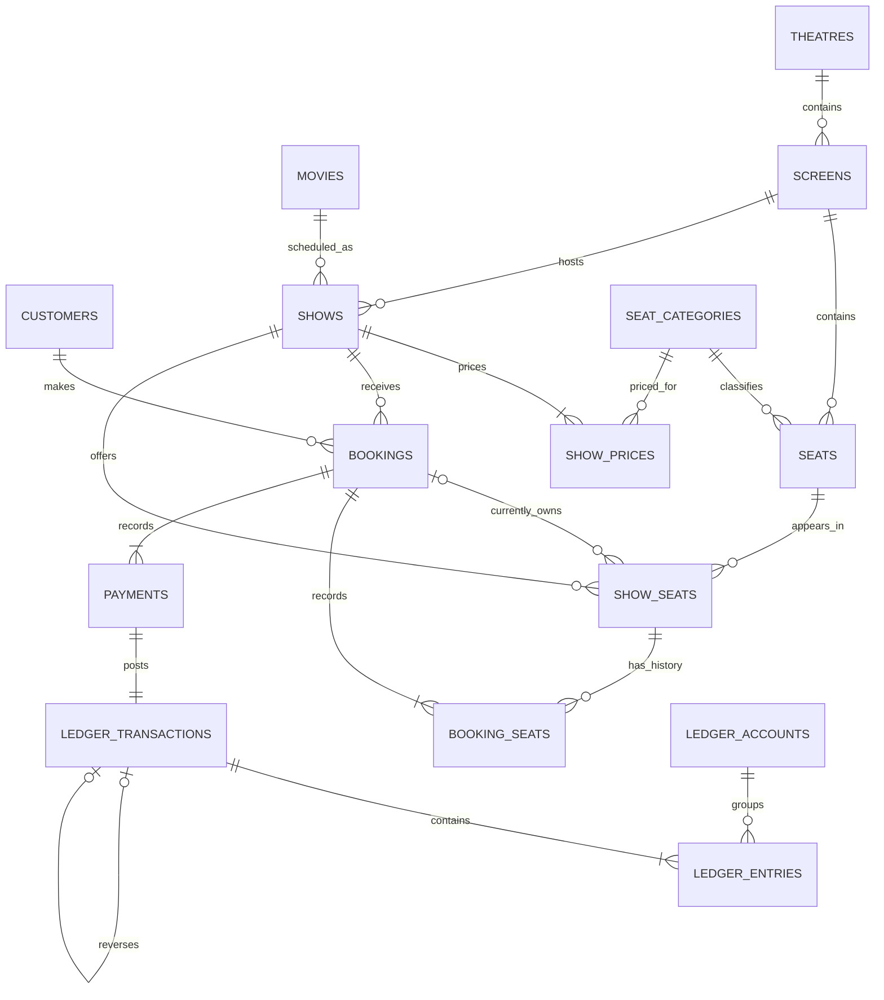

# Entity relationships

`show_seats` is current inventory; `booking_seats` is historical membership. The composite keys validate that a booking and its seat allocation refer to the same show, and that every seat belongs to the show's screen.

Every payment/refund posts one journal with two entries. Refund journals reference the original payment journal through reverses_id. Journal and payment records reject UPDATE, DELETE, and TRUNCATE; deferred constraints verify balances at commit.

`show_prices` defines each show's three category prices; `booking_seats.price_paise` and `category_name` preserve the actual sale independently of later admin changes. The schema now has fifteen tables: ten core booking tables, three ledger tables, and two category/pricing tables.
